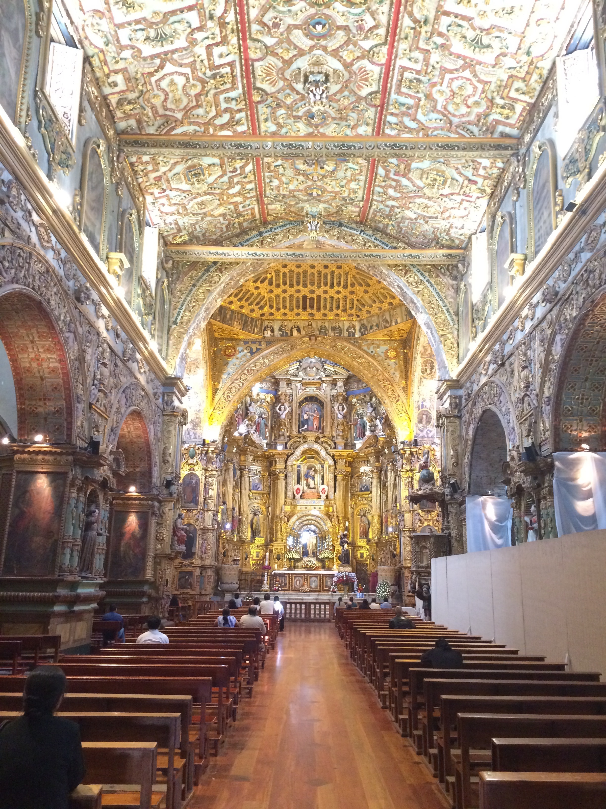

<div align="center">

# 🏛️ Museo de San Francisco de Quito

### Sitio web interactivo sobre el "Escorial de los Andes"

Un recorrido digital por más de cuatro siglos de historia, arte barroco y patrimonio cultural del **Complejo Arquitectónico de San Francisco**, en el corazón del Centro Histórico de Quito, Ecuador.

<br />

[](https://xernyx.github.io/museo-san-francisco/)


</div>

---

## 📑 Tabla de contenido

- [Sobre el proyecto](#-sobre-el-proyecto)
- [Características](#-características)
- [Secciones del sitio](#-secciones-del-sitio)
- [Estructura del proyecto](#-estructura-del-proyecto)
- [Ejecución en local](#-ejecución-en-local)
- [Autor](#-autor)
- [Licencia](#-licencia)

---

## 📖 Sobre el proyecto

Este sitio web presenta el **Museo Fray Jodoco Ricke**, ubicado en la Plaza de San Francisco de Quito. Reúne información histórica, horarios y tarifas, contenido multimedia, un mapa de ubicación y una **evaluación interactiva** para poner a prueba lo aprendido.

Fue desarrollado como trabajo autónomo del curso **W3Cx: HTML5 and CSS Fundamentals** (edX), con el objetivo de difundir el patrimonio cultural local mediante una experiencia digital clara y responsiva.

---

## 🖼️ Vista previa

<div align="center">

| Fachada nocturna | Claustro y jardines |
| :---: | :---: |
|  |  |

| Altar mayor | Plaza de San Francisco |
| :---: | :---: |
|  |  |

</div>

---

## ✨ Características

- 🏛️ **Contenido histórico** sobre el complejo, la Escuela Quiteña y sus principales obras.
- 🕒 **Horarios y tarifas** de ingreso en una tabla clara.
- 🎬 **Galería multimedia** con imágenes, un documental en video y música ambiental.
- 📍 **Mapa interactivo** de Google Maps incrustado para llegar al museo.
- 📝 **Evaluación interactiva** de 5 preguntas con calificación automática y retroalimentación según el puntaje.
- 📱 **Diseño responsivo** para móvil, tableta y escritorio.
- 🔤 **Tipografía cuidada** con *Playfair Display* y *Lora* (Google Fonts).

---

## 🧭 Secciones del sitio

| Sección | Ancla | Contenido |
| --- | --- | --- |
| **Historia y Obras** | `#historia` | Historia del complejo, tesoros de la Escuela Quiteña, horarios y tarifas |
| **Galería Multimedia** | `#multimedia` | Imágenes, documental en video y música ambiental |
| **Ubicación y Vistas** | `#ubicacion` | Mosaico de vistas y mapa de Google Maps |
| **Evalúa tus Conocimientos** | `#evaluacion` | Quiz de 5 preguntas con nota sobre 10 |

### 🎯 Cómo funciona la evaluación

El script `src/js/app.js` valida que se respondan las 5 preguntas, calcula la nota sobre 10 y muestra un mensaje con color según el resultado:

| Nota | Resultado |
| :---: | --- |
| **8 – 10** | 🟢 Excelente trabajo |
| **6 – 7.9** | 🟡 Buen intento, conviene repasar |
| **0 – 5.9** | 🔴 Vuelve a leer las secciones de historia |

---

## 🛠️ Tecnologías

| Área | Herramienta |
| --- | --- |
| Estructura | HTML5 semántico |
| Estilos | CSS3 |
| Lógica | JavaScript (ES6+) |
| Fuentes | Google Fonts |
| Mapa | Google Maps (iframe) |
| Despliegue | GitHub Actions + GitHub Pages |

---

## 📂 Estructura del proyecto

```text
museo-san-francisco/
├── .github/
│   └── workflows/
│       └── static.yml        # Despliegue automático a GitHub Pages
├── public/
│   ├── img/                  # Fotografías y certificado
│   ├── audio/                # Música ambiental (musica.mp3)
│   ├── video/                # Documental (recorrido.mp4)
│   ├── favicon.ico
│   ├── icon.png / icon.svg
│   ├── site.webmanifest
│   └── robots.txt
├── src/
│   ├── css/style.css         # Estilos del sitio
│   ├── js/app.js             # Lógica de la evaluación interactiva
│   └── 404.html
├── index.html                # Página principal
├── package.json
├── webpack.*.js              # Configuración de Webpack (heredada de la plantilla base)
├── LICENSE.txt
└── README.md
```

---

## 🚀 Ejecución en local

El sitio es estático, por lo que no necesita compilación para verse.

**1. Clona el repositorio**

```bash
git clone https://github.com/xErnyx/museo-san-francisco.git
cd museo-san-francisco
```

**2. Abre el sitio**

- **Opción A:** abre `index.html` directamente en tu navegador.
- **Opción B:** levanta un servidor local (recomendado para video y audio):

```bash
npx serve .
```

Luego entra a la dirección que muestre la terminal (normalmente `http://localhost:3000`).

---

## ☁️ Despliegue

Cada vez que se hace *push* a la rama `master`, el workflow [`static.yml`](.github/workflows/static.yml) publica automáticamente el sitio en **GitHub Pages**:

```text
push a master  ➜  GitHub Actions  ➜  GitHub Pages
```

🌐 Sitio publicado: **https://xernyx.github.io/museo-san-francisco/**

---

## 👤 Autor

**Juan David Figueroa Miño**
Trabajo autónomo – Curso *W3Cx: HTML5 and CSS Fundamentals* (edX)

[](https://github.com/xErnyx)

---

## 📄 Licencia

Este proyecto se distribuye bajo la licencia **MIT**. Consulta el archivo [`LICENSE.txt`](LICENSE.txt) para más detalles.

<div align="center">

<sub>Hecho con ❤️ para difundir el patrimonio cultural de Quito.</sub>

</div>
